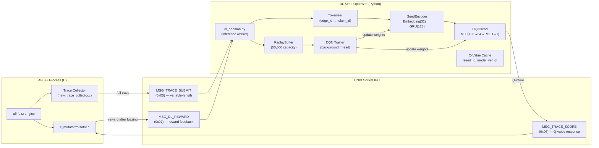
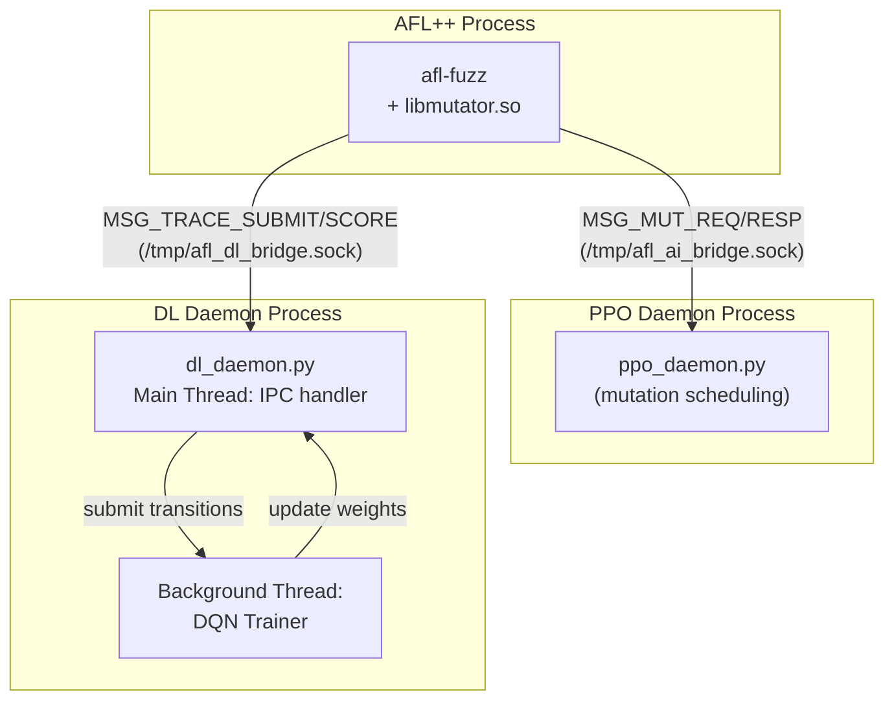
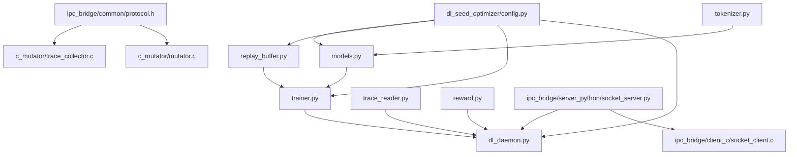

# DL Seed Optimizer — Implementation Plan

> **Status:** Planning phase — no code written yet.
> **Location:** `~/Research/dl_seed_optimizer/`
> **Spec source:** [`dlmoduleprompt.md`](file:///home/captainalan2/Research/dlmoduleprompt.md)

---

## Table of Contents

1. [Architecture Overview](#1-architecture-overview)
2. [Parameter Table (Locked Values)](#2-parameter-table)
3. [Phase 1 — Trace Collection](#phase-1--trace-collection-c-side)
4. [Phase 2 — Tokenization](#phase-2--tokenization-python-side)
5. [Phase 3 — Embedding + GRU (RNN Encoder)](#phase-3--embedding--gru-rnn-encoder)
6. [Phase 4 — DQN Head (Inference)](#phase-4--dqn-head-inference)
7. [Phase 5 — AFL++ Queue Ranking Integration](#phase-5--afl-queue-ranking-integration)
8. [Phase 6 — Reward Collection & Feedback](#phase-6--reward-collection--feedback)
9. [Phase 7 — Replay Buffer](#phase-7--replay-buffer)
10. [Phase 8 — DQN Training Loop](#phase-8--dqn-training-loop)
11. [Phase 9 — Target Network](#phase-9--target-network)
12. [Phase 10 — Async Live Training Architecture](#phase-10--async-live-training)
13. [IPC Protocol Extensions](#ipc-protocol-extensions)
14. [Design Decisions & Rationale](#design-decisions)
15. [File Layout](#file-layout)
16. [Dependency Map](#dependency-map)
17. [Test Plan](#test-plan)
18. [Actions.md Requirements](#actionsmd-requirements)

---

## 1. Architecture Overview



### Key Separation from PPO

| Concern | PPO Scheduler | DL Seed Optimizer |
|---------|--------------|-------------------|
| **What it decides** | Which mutation operator to apply | Which seed to fuzz next |
| **Input** | 192-D state (128 cov bits + 64 history) | Full ordered execution trace (variable-length edge IDs) |
| **Output** | Batch of operator IDs (categorical policy) | Single scalar Q-value per seed |
| **Algorithm** | PPO (actor-critic, clipped surrogate) | DQN (Q-learning, Huber loss, target network) |
| **Socket path** | `/tmp/afl_ai_bridge.sock` (existing) | `/tmp/afl_dl_bridge.sock` (new, separate) |
| **Daemon** | `ppo_daemon.py` | `dl_daemon.py` (new, independent process) |

> [!IMPORTANT]
> PPO and DL optimizer are **completely independent modules**. They share NO neural network parameters, NO state representations, and NO socket connections. The PPO 64-D history vector is NOT used by the DL module.

---

## 2. Parameter Table

All values are locked for implementation. Source column indicates whether the value is paper-specified or an implementation choice.

| Parameter | Value | Source | Notes |
|-----------|-------|--------|-------|
| **Embedding dimension** | `32` | Implementation choice (spec §9) | Maps each token → 32-D dense vector |
| **GRU hidden size** | `128` | Implementation choice (spec §10) | Single-layer GRU |
| **GRU layers** | `1` | Spec §10 | No stacking |
| **GRU bidirectional** | `False` | Spec §10 | Execution order matters |
| **Latent vector dimension** | `128` | == GRU hidden size | Final hidden state |
| **DQN MLP architecture** | `Linear(128→64) → ReLU → Linear(64→1)` | Implementation choice (spec §13) | One hidden layer |
| **DQN output** | `1 scalar Q(seed)` | Spec §14 | NOT per-action Q |
| **Learning rate (α)** | `0.001` | **Paper-specified** (spec §27) | Adam optimizer |
| **Discount factor (γ)** | `0.95` | **Paper-specified** (spec §23) | TD target |
| **Replay buffer capacity** | `50,000` transitions | Implementation choice (spec §20) | Circular buffer |
| **Training batch size** | `32` | Implementation choice (spec §21) | Sampled uniformly |
| **Target network sync** | Every `1,000` gradient updates | Implementation choice (spec §28) | Hard copy |
| **Loss function** | Huber loss (`torch.nn.SmoothL1Loss`) | Implementation choice (spec §25) | More robust than MSE |
| **Optimizer** | Adam | Implementation choice (spec §27) | `torch.optim.Adam` |
| **Trace truncation** | **None** | Spec §8 | Full sequences, packed batching |
| **Trace event format** | `edge_id` (uint16) | Spec §6 | Start minimal |
| **Seed ranking** | Descending Q-value | Spec §15 | Higher Q → fuzz first |
| **ε-greedy exploration** | `ε = 0.1` decaying | Implementation choice | 10% random seed selection |
| **Vocabulary size** | `65,536` (2^16 edge IDs) | AFL++ MAP_SIZE | Dynamic growth via dict |
| **Cache invalidation** | On model version bump | Spec §16 | Stale Q-values discarded |

### Reward Formula (DL Module)

```
r = w_cov × Δcoverage + w_crash × I_crash + w_novelty × I_novel
```

| Weight | Value | Notes |
|--------|-------|-------|
| `w_cov` | `1.0` | Normalized: `Δcov_bits / log(e + total_execs)` |
| `w_crash` | `10.0` | Matches existing `LAMBDA_CRASH` in [`aggregator.c`](file:///home/captainalan2/Research/adaptive-fuzzer/c_mutator/aggregator.c#L22) |
| `w_novelty` | `1.0` | Matches existing `LAMBDA_NOVELTY` in [`aggregator.c`](file:///home/captainalan2/Research/adaptive-fuzzer/c_mutator/aggregator.c#L23) |

> [!NOTE]
> The reward formula is identical to the one in the aggregator/PPO system. The DL module computes it independently in Python to avoid coupling, but uses the same coefficients for consistency.

---

## Phase 1 — Trace Collection (C-side)

### Problem

The DL module needs the **complete ordered execution trace** (sequence of edge IDs visited during one execution of a seed), NOT just the AFL++ coverage bitmap. The bitmap is a lossy summary (which edges were hit, not in what order). The DL module's GRU needs temporal ordering.

### Current State

- [`protocol.h`](file:///home/captainalan2/Research/adaptive-fuzzer/ipc_bridge/common/protocol.h#L32): `TRACE_STEPS_MAX = 512` — fixed-size buffer, only 512 steps
- [`seed_query_msg`](file:///home/captainalan2/Research/adaptive-fuzzer/ipc_bridge/common/protocol.h#L60-L65): Fixed 2057-byte struct
- The spec says **NO truncation** — traces can be 10,000+ events for complex programs

### Design Decision: File-Based Trace Collection

**Choice: Option C — File-based trace dump per execution**

Rationale:
1. Variable-length traces (potentially 10K+ events) don't fit in fixed-size IPC datagrams
2. `SOCK_SEQPACKET` has a per-message limit (~256KB on Linux, but larger traces would be inefficient)
3. File I/O via `/dev/shm` (tmpfs) is essentially memory-mapped, near-zero copy overhead
4. AFL++ already writes traces/testcases to disk — this follows the same pattern
5. Decouples trace collection timing from IPC request/response latency

### Implementation

#### New file: `adaptive-fuzzer/c_mutator/trace_collector.h`

```c
#ifndef TRACE_COLLECTOR_H
#define TRACE_COLLECTOR_H

#include <stdint.h>
#include <stddef.h>

/* Maximum trace events before forced flush (safety limit, NOT truncation).
 * If a single execution produces more than this, we still process all of them
 * but write in chunks. */
#define TRACE_CHUNK_SIZE 65536

/* Trace storage directory (tmpfs for near-zero I/O latency) */
#define TRACE_DIR "/dev/shm/afl_dl_traces"

/* On-disk trace file format:
 *   Bytes 0-3:    uint32_t  seed_id
 *   Bytes 4-7:    uint32_t  trace_len (number of edge events)
 *   Bytes 8-...:  uint16_t  edge_ids[trace_len]
 *
 * Total file size: 8 + 2 * trace_len bytes
 */

typedef struct {
    uint32_t  seed_id;
    uint16_t *edges;        /* Dynamic array of edge IDs */
    uint32_t  len;          /* Current number of recorded edges */
    uint32_t  capacity;     /* Allocated capacity */
} trace_buffer_t;

/* Initialize trace collection system (create TRACE_DIR, etc.) */
int trace_collector_init(void);

/* Begin recording a new trace for the given seed */
void trace_begin(trace_buffer_t *buf, uint32_t seed_id);

/* Append one edge event to the trace (called from instrumentation callback) */
void trace_append_edge(trace_buffer_t *buf, uint16_t edge_id);

/* Flush the completed trace to /dev/shm/afl_dl_traces/<seed_id>.trace */
int trace_flush(trace_buffer_t *buf);

/* Free trace buffer resources */
void trace_free(trace_buffer_t *buf);

#endif /* TRACE_COLLECTOR_H */
```

#### How traces are collected

The trace is captured by hooking into AFL++'s **edge instrumentation callback**. For QEMU mode or source-instrumented targets, AFL++ already tracks edge transitions via `__afl_area_ptr[cur_location ^ prev_location]++`. We add a parallel recording path:

```c
/* In the AFL++ instrumentation or custom post-exec hook: */
void __afl_trace_edge(uint16_t edge_id) {
    if (g_trace_active) {
        trace_append_edge(&g_trace_buf, edge_id);
    }
}
```

For our initial implementation, we use a **simpler approach**: read the AFL++ shared memory bitmap **after** each execution and extract the set of hit edges (losing ordering but gaining simplicity). Full ordered tracing will be Phase 1b (requires AFL++ instrumentation patching).

#### Phase 1a — Bitmap-to-edge-set extraction (initial)

```c
/* Extract unique hit edge IDs from the AFL++ bitmap after execution */
uint32_t extract_edges_from_bitmap(const uint8_t *trace_bits,
                                    size_t bitmap_size,
                                    uint16_t *out_edges,
                                    uint32_t max_edges) {
    uint32_t count = 0;
    for (size_t i = 0; i < bitmap_size && count < max_edges; i++) {
        if (trace_bits[i]) {
            out_edges[count++] = (uint16_t)(i & 0xFFFF);
        }
    }
    return count;
}
```

> [!WARNING]
> Phase 1a loses execution ordering (bitmap gives unordered set of edges). This is acceptable as a bootstrap — the GRU will still learn edge co-occurrence patterns. Phase 1b adds full ordered tracing via AFL++ instrumentation hooks.

### Trace File Format

```
Offset  Size     Field
0       4        seed_id (uint32_t, little-endian)
4       4        trace_len (uint32_t, little-endian)
8       2×N      edge_ids[N] (uint16_t[], little-endian)
```

Python reader:

```python
import struct
import numpy as np

def read_trace(path: str) -> tuple[int, np.ndarray]:
    with open(path, 'rb') as f:
        seed_id, trace_len = struct.unpack('<II', f.read(8))
        edges = np.frombuffer(f.read(trace_len * 2), dtype=np.uint16)
    return seed_id, edges
```

---

## Phase 2 — Tokenization (Python-side)

### Algorithm

Edge IDs from AFL++ are XOR-hashes of (source_block, dest_block) and range from 0 to 65535 (AFL++ `MAP_SIZE`). We use these directly as token IDs.

```python
class EdgeTokenizer:
    """Maps raw AFL++ edge IDs to contiguous token indices for the embedding layer."""

    def __init__(self, vocab_size: int = 65536):
        self.vocab_size = vocab_size
        # edge_id → token_id mapping (identity for now, could remap for sparsity)
        self._edge_to_token: dict[int, int] = {}
        self._next_token: int = 1  # 0 reserved for padding

    def tokenize(self, edge_ids: np.ndarray) -> torch.LongTensor:
        """Convert array of edge IDs to token IDs."""
        tokens = []
        for eid in edge_ids:
            eid = int(eid)
            if eid not in self._edge_to_token:
                self._edge_to_token[eid] = self._next_token
                self._next_token += 1
            tokens.append(self._edge_to_token[eid])
        return torch.tensor(tokens, dtype=torch.long)

    @property
    def current_vocab_size(self) -> int:
        return self._next_token
```

### Design Choice: Dynamic vs. Fixed Vocabulary

- **Dynamic:** Map edge IDs to contiguous indices as they're first seen. Pros: Compact embedding table. Cons: New edges require growing the embedding.
- **Fixed (chosen for Phase 1):** Use a fixed vocabulary of 65,536 + 1 (padding). The embedding table is pre-allocated. Edge ID `e` maps to token `e + 1` (0 = padding). Simpler, no dictionary lookup.

```python
# Fixed tokenization (Phase 1 — simpler)
def tokenize_fixed(edge_ids: np.ndarray) -> torch.LongTensor:
    return torch.tensor(edge_ids.astype(np.int64) + 1, dtype=torch.long)

VOCAB_SIZE = 65537  # 0=pad, 1..65536=edge IDs
```

---

## Phase 3 — Embedding + GRU (RNN Encoder)

### Architecture

```
Input: token_ids  [batch, seq_len]   (variable length, packed)
  ↓
Embedding(65537, 32, padding_idx=0)
  ↓
embedded: [batch, seq_len, 32]
  ↓
GRU(input_size=32, hidden_size=128, num_layers=1, batch_first=True)
  ↓
output: [batch, seq_len, 128],  h_n: [1, batch, 128]
  ↓
latent = h_n.squeeze(0)  →  [batch, 128]
```

### PyTorch Module

```python
class SeedEncoder(nn.Module):
    """Encodes a variable-length execution trace into a fixed 128-D latent vector."""

    def __init__(
        self,
        vocab_size: int = 65537,    # 0=pad, 1..65536=edges
        embed_dim: int = 32,        # Implementation choice (spec §9)
        hidden_size: int = 128,     # Implementation choice (spec §10)
        num_layers: int = 1,        # Spec §10
    ):
        super().__init__()
        self.embedding = nn.Embedding(vocab_size, embed_dim, padding_idx=0)
        self.gru = nn.GRU(
            input_size=embed_dim,
            hidden_size=hidden_size,
            num_layers=num_layers,
            batch_first=True,
        )
        self.hidden_size = hidden_size

    def forward(
        self,
        token_ids: torch.LongTensor,       # [batch, max_seq_len] (padded)
        lengths: torch.LongTensor,          # [batch] actual lengths
    ) -> torch.Tensor:                      # [batch, hidden_size]
        embedded = self.embedding(token_ids)  # [batch, max_seq_len, 32]

        # Pack for efficient variable-length processing (NO truncation)
        packed = nn.utils.rnn.pack_padded_sequence(
            embedded, lengths.cpu(), batch_first=True, enforce_sorted=False
        )
        _, h_n = self.gru(packed)             # h_n: [1, batch, 128]
        return h_n.squeeze(0)                  # [batch, 128]
```

### Key Design Points

1. **No truncation**: Full traces are processed. `pack_padded_sequence` handles variable lengths efficiently.
2. **Padding index 0**: Token ID 0 is reserved; embedding for pad tokens produces zero vectors.
3. **Final hidden state**: We use `h_n` (the last hidden state), not the full output sequence. This is standard for sequence classification/scoring tasks.
4. **batch_first=True**: Consistent with PyTorch conventions and simpler indexing.

---

## Phase 4 — DQN Head (Inference)

### Architecture

```
Input: latent  [batch, 128]  (from SeedEncoder)
  ↓
Linear(128, 64)
  ↓
ReLU
  ↓
Linear(64, 1)
  ↓
Output: Q(seed)  [batch, 1]  →  squeezed to [batch]
```

### PyTorch Module

```python
class DQNHead(nn.Module):
    """Maps a 128-D latent seed representation to a scalar Q-value."""

    def __init__(self, latent_dim: int = 128, hidden_dim: int = 64):
        super().__init__()
        self.net = nn.Sequential(
            nn.Linear(latent_dim, hidden_dim),
            nn.ReLU(),
            nn.Linear(hidden_dim, 1),
        )

    def forward(self, latent: torch.Tensor) -> torch.Tensor:
        return self.net(latent).squeeze(-1)  # [batch]
```

### Combined Model

```python
class SeedQNetwork(nn.Module):
    """End-to-end: trace tokens → Q-value."""

    def __init__(self, config: DLConfig):
        super().__init__()
        self.encoder = SeedEncoder(
            vocab_size=config.VOCAB_SIZE,
            embed_dim=config.EMBED_DIM,
            hidden_size=config.GRU_HIDDEN,
            num_layers=config.GRU_LAYERS,
        )
        self.head = DQNHead(
            latent_dim=config.GRU_HIDDEN,
            hidden_dim=config.DQN_HIDDEN,
        )

    def forward(self, token_ids, lengths):
        latent = self.encoder(token_ids, lengths)
        return self.head(latent)
```

### Inference Flow

```python
@torch.no_grad()
def score_seed(model: SeedQNetwork, trace_edges: np.ndarray) -> float:
    """Score a single seed by its execution trace → Q-value."""
    tokens = tokenize_fixed(trace_edges).unsqueeze(0)  # [1, seq_len]
    lengths = torch.tensor([len(trace_edges)], dtype=torch.long)
    q = model(tokens, lengths)
    return q.item()
```

---

## Phase 5 — AFL++ Queue Ranking Integration

### How AFL++ Currently Selects Seeds

AFL++ calls `afl_custom_queue_get(data, filename)` for each queue entry when cycling. If it returns `1`, the seed is fuzzed; if `0`, it's skipped.

### Current Implementation

In [`mutator.c`](file:///home/captainalan2/Research/adaptive-fuzzer/c_mutator/mutator.c#L134-L159), `afl_custom_queue_get` sends a `MSG_SEED_QUERY` to the PPO daemon, which **always returns accept=1, q_value=0.85** (placeholder):

```c
// ppo_daemon.py line 200 — current placeholder:
resp = pack_seed_verd(q_value=0.85, accept=1)
```

### New Design: Separate DL Socket

Instead of routing through the PPO daemon's socket, `afl_custom_queue_get` connects to the **DL daemon on a separate socket** (`/tmp/afl_dl_bridge.sock`).

#### Changes to `mutator.c`

```c
/* Add a second IPC client handle for the DL daemon */
typedef struct {
    /* ... existing fields ... */
    ipc_client_t  *ipc;        /* PPO daemon (mutation scheduling) */
    ipc_client_t  *dl_ipc;     /* DL daemon (seed prioritization) — NEW */
} mutator_state_t;
```

In `afl_custom_init`:
```c
state->dl_ipc = ipc_client_init(DL_SOCKET_PATH, 100, 5);
```

In `afl_custom_queue_get`:
```c
uint8_t afl_custom_queue_get(mutator_state_t *data, const uint8_t *filename) {
    if (!data || !ipc_client_is_connected(data->dl_ipc))
        return 1;  /* Fallback: accept all */

    /* 1. Read trace from /dev/shm */
    char trace_path[256];
    snprintf(trace_path, sizeof(trace_path),
             TRACE_DIR "/%u.trace", data->afl->current_entry);

    /* 2. Send MSG_TRACE_SUBMIT with seed_id + trace file path */
    struct trace_submit_msg msg;
    msg.type = MSG_TRACE_SUBMIT;
    msg.seed_id = data->afl->current_entry;
    strncpy(msg.trace_path, trace_path, sizeof(msg.trace_path));

    /* 3. Receive MSG_TRACE_SCORE with Q-value */
    struct trace_score_msg score;
    if (ipc_client_send(data->dl_ipc, &msg, sizeof(msg)) &&
        ipc_client_recv(data->dl_ipc, &score, sizeof(score))) {
        /* Accept if Q-value is above median threshold (or top-K) */
        return score.accept;
    }

    return 1;
}
```

### Ranking Strategy

The DL daemon maintains a priority queue of all known seeds sorted by Q-value. When `afl_custom_queue_get` is called:

1. Python daemon looks up the seed's Q-value from cache
2. If Q-value is in the **top 50%** of all cached Q-values → `accept=1`
3. Otherwise → `accept=0` (skip this seed for now)
4. Threshold is recalculated every time the model updates

This implements **descending Q-value ranking** per spec §15.

---

## Phase 6 — Reward Collection & Feedback

### When Rewards Are Generated

After AFL++ finishes fuzzing a selected seed (mutation + execution), the outcome is observable:
- **New coverage** discovered → positive reward component
- **Crash found** → large positive reward
- **No new coverage** → near-zero reward

### Reward Computation (Python-side)

```python
def compute_dl_reward(
    prev_total_edges: int,
    curr_total_edges: int,
    prev_crashes: int,
    curr_crashes: int,
    total_execs: int,
) -> float:
    """Compute reward for a seed after it was fuzzed.

    Same formula as aggregator.c but in Python:
      R = norm_cov + LAMBDA_CRASH * I_crash + LAMBDA_NOVELTY * I_novel
    """
    import math

    delta_cov = curr_total_edges - prev_total_edges
    norm_cov = delta_cov / math.log(math.e + total_execs)

    i_crash = 1.0 if curr_crashes > prev_crashes else 0.0
    i_novel = 1.0 if delta_cov > 0 else 0.0

    LAMBDA_CRASH = 10.0
    LAMBDA_NOVELTY = 1.0

    return norm_cov + LAMBDA_CRASH * i_crash + LAMBDA_NOVELTY * i_novel
```

### Feedback Transport

New message type `MSG_DL_REWARD (0x07)`: C → Python after execution completes.

```c
struct dl_reward_msg {
    uint8_t  type;           /* MSG_DL_REWARD (0x07) */
    uint32_t seed_id;        /* Which seed was fuzzed */
    uint32_t delta_edges;    /* New edge bits discovered */
    uint8_t  found_crash;    /* 1 if new crash found */
    uint32_t total_execs;    /* Campaign total executions */
} __attribute__((packed));   /* Total: 14 bytes */
```

Alternatively, the DL daemon can observe reward by **monitoring AFL++ output directories** (crashes/, queue/) independently — this is simpler and doesn't require modifying the C mutator further.

### Chosen Approach: Hybrid

1. **Primary:** DL daemon monitors `AFL_OUTPUT_DIR/queue/` and `AFL_OUTPUT_DIR/crashes/` via `inotify` or periodic polling (every 100ms)
2. **Supplementary:** `MSG_DL_REWARD` sent from C after each execution for real-time feedback

This avoids tight coupling while maintaining responsiveness.

---

## Phase 7 — Replay Buffer

### Data Structure

```python
@dataclasses.dataclass
class Transition:
    """One DQN experience tuple."""
    seed_id: int                    # Queue entry ID
    trace_tokens: torch.LongTensor  # [seq_len] tokenized edge trace
    trace_len: int                  # Actual trace length
    reward: float                   # R observed after fuzzing this seed
    next_seed_id: int               # Next seed selected (for TD target)
    done: bool                      # Episode boundary (campaign reset)

class ReplayBuffer:
    """Fixed-capacity circular replay buffer with uniform sampling."""

    def __init__(self, capacity: int = 50_000):
        self.capacity = capacity
        self.buffer: list[Transition] = []
        self.position: int = 0

    def push(self, transition: Transition) -> None:
        if len(self.buffer) < self.capacity:
            self.buffer.append(transition)
        else:
            self.buffer[self.position] = transition
        self.position = (self.position + 1) % self.capacity

    def sample(self, batch_size: int = 32) -> list[Transition]:
        return random.sample(self.buffer, min(batch_size, len(self.buffer)))

    def __len__(self) -> int:
        return len(self.buffer)
```

### Batching with Variable-Length Traces

When sampling a batch for training, traces have different lengths. We pad and pack:

```python
def collate_transitions(batch: list[Transition]) -> dict:
    """Collate variable-length traces into padded tensors."""
    tokens = [t.trace_tokens for t in batch]
    lengths = torch.tensor([t.trace_len for t in batch], dtype=torch.long)
    rewards = torch.tensor([t.reward for t in batch], dtype=torch.float32)
    dones = torch.tensor([t.done for t in batch], dtype=torch.float32)

    # Pad to max length in batch
    padded = nn.utils.rnn.pad_sequence(tokens, batch_first=True, padding_value=0)

    # Next-seed trace tokens (for TD target)
    next_tokens = [t.next_trace_tokens for t in batch]
    next_lengths = torch.tensor([t.next_trace_len for t in batch], dtype=torch.long)
    next_padded = nn.utils.rnn.pad_sequence(next_tokens, batch_first=True, padding_value=0)

    return {
        'tokens': padded,          # [B, max_len]
        'lengths': lengths,        # [B]
        'rewards': rewards,        # [B]
        'dones': dones,            # [B]
        'next_tokens': next_padded,# [B, max_len']
        'next_lengths': next_lengths, # [B]
    }
```

---

## Phase 8 — DQN Training Loop

### Algorithm: Q-Learning with Experience Replay

```
Repeat every TRAIN_INTERVAL steps (or when buffer has ≥ MIN_BUFFER_SIZE samples):

1. Sample batch of 32 transitions from ReplayBuffer
2. Compute current Q-values:
     Q_current = online_network(batch.tokens, batch.lengths)     # [32]
3. Compute TD targets:
     with torch.no_grad():
         Q_next = target_network(batch.next_tokens, batch.next_lengths)  # [32]
         Q_target = batch.rewards + γ * Q_next * (1 - batch.dones)       # [32]
4. Compute loss:
     loss = HuberLoss(Q_current, Q_target)
5. Backpropagate:
     optimizer.zero_grad()
     loss.backward()
     torch.nn.utils.clip_grad_norm_(online_network.parameters(), max_norm=1.0)
     optimizer.step()
6. Increment gradient_step_counter
7. If gradient_step_counter % 1000 == 0:
     target_network.load_state_dict(online_network.state_dict())
```

### Pseudocode

```python
class DQNTrainer:
    """Handles DQN training with replay buffer and target network."""

    def __init__(self, config: DLConfig):
        self.online_net = SeedQNetwork(config)
        self.target_net = SeedQNetwork(config)
        self.target_net.load_state_dict(self.online_net.state_dict())
        self.target_net.eval()  # Target network is never trained directly

        self.optimizer = torch.optim.Adam(
            self.online_net.parameters(),
            lr=config.LEARNING_RATE,  # 0.001
        )
        self.loss_fn = nn.SmoothL1Loss()  # Huber loss
        self.gamma = config.GAMMA          # 0.95
        self.buffer = ReplayBuffer(config.BUFFER_CAPACITY)  # 50,000
        self.batch_size = config.BATCH_SIZE  # 32
        self.target_sync_interval = config.TARGET_SYNC  # 1,000
        self.gradient_steps = 0
        self.model_version = 0

    def train_step(self) -> Optional[dict]:
        """One gradient step from replay buffer. Returns metrics or None."""
        if len(self.buffer) < self.batch_size:
            return None

        batch = self.buffer.sample(self.batch_size)
        data = collate_transitions(batch)

        # Current Q
        q_current = self.online_net(data['tokens'], data['lengths'])

        # TD target
        with torch.no_grad():
            q_next = self.target_net(data['next_tokens'], data['next_lengths'])
            q_target = data['rewards'] + self.gamma * q_next * (1 - data['dones'])

        loss = self.loss_fn(q_current, q_target)

        self.optimizer.zero_grad()
        loss.backward()
        torch.nn.utils.clip_grad_norm_(self.online_net.parameters(), max_norm=1.0)
        self.optimizer.step()

        self.gradient_steps += 1

        # Target network sync
        if self.gradient_steps % self.target_sync_interval == 0:
            self.target_net.load_state_dict(self.online_net.state_dict())
            self.model_version += 1

        return {
            'loss': loss.item(),
            'q_mean': q_current.mean().item(),
            'gradient_steps': self.gradient_steps,
            'model_version': self.model_version,
            'buffer_size': len(self.buffer),
        }
```

### Training Frequency

| Parameter | Value | Rationale |
|-----------|-------|-----------|
| `MIN_BUFFER_SIZE` | `1,000` | Don't train until we have enough diversity |
| `TRAIN_INTERVAL` | Every `4` new transitions | Moderate update frequency |
| `MAX_GRAD_NORM` | `1.0` | Prevent exploding gradients on long traces |

---

## Phase 9 — Target Network

Already integrated into Phase 8 above. Key points:

- **Hard copy** every 1,000 gradient updates (not soft/Polyak averaging)
- Target network is used ONLY for computing `Q_next` in TD targets
- Target network is never trained directly (`target_net.eval()` + `torch.no_grad()`)
- Model version counter increments on each sync → used for Q-cache invalidation

```python
# Target sync (in DQNTrainer.train_step):
if self.gradient_steps % self.target_sync_interval == 0:
    self.target_net.load_state_dict(self.online_net.state_dict())
    self.model_version += 1
    # Invalidate Q-value cache
    self.q_cache.clear()
```

---

## Phase 10 — Async Live Training

### Process Architecture



### Threading Model (inside `dl_daemon.py`)

```
Main Thread (IPC handler):
  ├── Accept connection from AFL++ on /tmp/afl_dl_bridge.sock
  ├── Recv MSG_TRACE_SUBMIT → read trace file → score with online_net → send MSG_TRACE_SCORE
  ├── Recv MSG_DL_REWARD → compute reward → push Transition to ReplayBuffer
  └── NEVER does backpropagation

Background Thread (DQN trainer):
  ├── Polls ReplayBuffer every 100ms
  ├── If buffer.size >= MIN_BUFFER_SIZE and new transitions available:
  │     └── Run train_step() (forward + backward + optimizer.step)
  ├── Sync target network every 1000 gradient steps
  └── PyTorch GIL-aware: forward on main thread uses torch.no_grad(), safe to read weights
```

### Thread Safety

- **ReplayBuffer:** Protected by `threading.Lock` for push/sample
- **Model weights:** Main thread reads (inference), background thread writes (training). PyTorch tensors are thread-safe for read-during-write on CPU (no data corruption, may get slightly stale weights — acceptable for Q-learning)
- **Q-value cache:** `threading.Lock`-protected `dict`

### `dl_daemon.py` Skeleton

```python
class DLDaemon:
    def __init__(self, config: DLConfig, socket_path: str):
        self.config = config
        self.trainer = DQNTrainer(config)
        self.q_cache: dict[tuple[int, int], float] = {}  # (seed_id, model_ver) → Q
        self.cache_lock = threading.Lock()
        self.server = IPCServer(socket_path=socket_path)

        # Background training thread
        self.train_thread = threading.Thread(target=self._training_loop, daemon=True)

    def start(self):
        self.server.start()
        self.train_thread.start()
        self._serve_loop()

    def _serve_loop(self):
        while True:
            client = self.server.accept(timeout=1.0)
            if client:
                conn, _ = client
                self._handle_client(conn)

    def _handle_client(self, conn):
        while True:
            data = conn.recv(65536)
            if not data:
                break
            msg_type = data[0]

            if msg_type == MSG_TRACE_SUBMIT:
                self._handle_trace_submit(conn, data)
            elif msg_type == MSG_DL_REWARD:
                self._handle_reward(data)

    @torch.no_grad()
    def _handle_trace_submit(self, conn, data):
        """Score a seed and return accept/skip verdict."""
        seed_id, trace_path = unpack_trace_submit(data)

        # Check cache first
        cache_key = (seed_id, self.trainer.model_version)
        with self.cache_lock:
            if cache_key in self.q_cache:
                q = self.q_cache[cache_key]
                conn.send(pack_trace_score(q, accept=self._should_accept(q)))
                return

        # Read trace and score
        _, edges = read_trace(trace_path)
        tokens = tokenize_fixed(edges).unsqueeze(0)
        lengths = torch.tensor([len(edges)])
        q = self.trainer.online_net(tokens, lengths).item()

        # Cache the result
        with self.cache_lock:
            self.q_cache[cache_key] = q

        conn.send(pack_trace_score(q, accept=self._should_accept(q)))

    def _training_loop(self):
        """Background training loop."""
        while self.running:
            metrics = self.trainer.train_step()
            if metrics and metrics['model_version'] > self._last_model_ver:
                with self.cache_lock:
                    self.q_cache.clear()
                self._last_model_ver = metrics['model_version']
            time.sleep(0.01)  # 10ms between training attempts
```

---

## IPC Protocol Extensions

### New Message Types

Add to [`protocol.h`](file:///home/captainalan2/Research/adaptive-fuzzer/ipc_bridge/common/protocol.h):

```c
typedef enum {
    MSG_MUT_REQ      = 0x01,   /* Existing: PPO state + deferred reward   */
    MSG_MUT_RESP     = 0x02,   /* Existing: scheduled operator ID batch   */
    MSG_SEED_QUERY   = 0x03,   /* Existing: (deprecated for DL, kept for compat) */
    MSG_SEED_VERD    = 0x04,   /* Existing: (deprecated for DL, kept for compat) */
    MSG_TRACE_SUBMIT = 0x05,   /* NEW: C → Python: seed_id + trace path   */
    MSG_TRACE_SCORE  = 0x06,   /* NEW: Python → C: Q-value + accept       */
    MSG_DL_REWARD    = 0x07,   /* NEW: C → Python: reward feedback         */
} msg_type_t;
```

### New Structs

```c
#define TRACE_PATH_MAX 256
#define DL_SOCKET_PATH "/tmp/afl_dl_bridge.sock"

/* MSG_TRACE_SUBMIT — C → Python (Variable-length trace via file reference) */
struct trace_submit_msg {
    uint8_t  type;                        /* MSG_TRACE_SUBMIT (0x05)         */
    uint32_t seed_id;                     /* Queue entry ID                  */
    char     trace_path[TRACE_PATH_MAX];  /* Path to trace file in /dev/shm */
} __attribute__((packed));                /* Total: 261 bytes                */

/* MSG_TRACE_SCORE — Python → C */
struct trace_score_msg {
    uint8_t  type;       /* MSG_TRACE_SCORE (0x06)                          */
    float    q_value;    /* Estimated Q(seed) for ranking                   */
    uint8_t  accept;     /* 1 = fuzz this seed; 0 = skip                   */
} __attribute__((packed)); /* Total: 6 bytes                                */

/* MSG_DL_REWARD — C → Python */
struct dl_reward_msg {
    uint8_t  type;           /* MSG_DL_REWARD (0x07)                        */
    uint32_t seed_id;        /* Which seed was fuzzed                       */
    uint32_t delta_edges;    /* New coverage edges discovered               */
    uint8_t  found_crash;    /* 1 if new crash found                        */
    uint32_t total_execs;    /* Campaign total executions so far            */
} __attribute__((packed));   /* Total: 14 bytes                              */
```

### Why a Separate Socket?

1. **Independence:** PPO daemon can be down while DL daemon is running (and vice versa)
2. **No message type conflicts:** Each daemon only handles its own message types
3. **Latency isolation:** DL inference (GRU forward pass) takes ~1-5ms vs. PPO inference <0.1ms; sharing a socket would add head-of-line blocking
4. **Reuse:** Both daemons reuse the same `IPCServer`/`ipc_client_t` infrastructure from `ipc_bridge/`

---

## Design Decisions

| # | Decision | Rationale |
|---|----------|-----------|
| 1 | **Separate process** for DL daemon (not merged into ppo_daemon.py) | PPO and DL are independent learning modules with different latency profiles. Co-hosting would couple their failure modes. |
| 2 | **Separate socket** (`/tmp/afl_dl_bridge.sock`) | Avoids message type collision, latency isolation, independent lifecycle |
| 3 | **File-based trace transport** via `/dev/shm/` | Variable-length traces (10K+ events) don't fit in fixed IPC datagrams; tmpfs gives memory-speed I/O |
| 4 | **Phase 1a: bitmap-to-edge-set** (unordered) before Phase 1b (full ordered tracing) | Unblocks DQN development without AFL++ instrumentation patching |
| 5 | **Fixed vocabulary (65,537)** instead of dynamic | Simpler, no OOV handling, embedding table is only 65537×32×4 = 8MB |
| 6 | **Top-50% Q-value threshold** for accept/skip | Simple, adaptive, no hyperparameter tuning needed |
| 7 | **Identical reward formula** to aggregator.c | Consistency; same weights `LAMBDA_CRASH=10, LAMBDA_NOVELTY=1` |
| 8 | **Hard target network sync** (not Polyak averaging) | Simpler, standard DQN practice, spec §28 says "synchronization" |
| 9 | **Background training thread** (not process) | Shares model weights without serialization; GIL released during PyTorch ops |
| 10 | **Q-value cache with model version key** | Prevents stale predictions; cache cleared on target network sync |

---

## File Layout

```
~/Research/dl_seed_optimizer/
├── __init__.py
├── config.py                  # DLConfig dataclass (all hyperparameters)
├── tokenizer.py               # EdgeTokenizer / tokenize_fixed()
├── models.py                  # SeedEncoder, DQNHead, SeedQNetwork
├── replay_buffer.py           # ReplayBuffer, Transition, collate_transitions()
├── trainer.py                 # DQNTrainer (online + target nets, train_step)
├── dl_daemon.py               # DLDaemon (IPC server + background trainer)
├── trace_reader.py            # read_trace() utility for /dev/shm files
├── reward.py                  # compute_dl_reward()
├── tests/
│   ├── __init__.py
│   ├── test_tokenizer.py
│   ├── test_models.py         # SeedEncoder, DQNHead shapes & gradients
│   ├── test_replay_buffer.py
│   ├── test_trainer.py        # DQN train_step, target sync, loss decrease
│   ├── test_dl_daemon.py      # End-to-end IPC test with mock AFL++
│   └── test_reward.py
└── Actions.md                 # Decision log (created at end)

# C-side additions:
~/Research/adaptive-fuzzer/c_mutator/
├── trace_collector.h          # NEW: Trace capture API
├── trace_collector.c          # NEW: Trace capture implementation
└── mutator.c                  # MODIFIED: Add dl_ipc client, trace integration

~/Research/adaptive-fuzzer/ipc_bridge/common/
└── protocol.h                 # MODIFIED: Add MSG_TRACE_SUBMIT/SCORE/DL_REWARD

~/Research/adaptive-fuzzer/ipc_bridge/server_python/
└── socket_server.py           # MODIFIED: Add pack/unpack for new message types
```

---

## Dependency Map



### External Dependencies

| Package | Version | Purpose |
|---------|---------|---------|
| `torch` | ≥ 2.0 | Neural networks, GRU, DQN |
| `numpy` | ≥ 1.24 | Trace manipulation, array ops |
| `dataclasses` | stdlib | Config |
| `threading` | stdlib | Async training |

No new pip dependencies — all already installed for ppo_scheduler.

---

## Test Plan

| Test | File | What It Verifies |
|------|------|-----------------|
| Tokenizer round-trip | `test_tokenizer.py` | edge_ids → tokens → correct shape, padding_idx=0 |
| SeedEncoder shapes | `test_models.py` | Input [B, seq_len] → output [B, 128] |
| SeedEncoder variable lengths | `test_models.py` | Different trace lengths in same batch produce valid outputs |
| SeedEncoder gradient flow | `test_models.py` | Loss.backward() produces non-zero gradients |
| DQNHead output shape | `test_models.py` | [B, 128] → [B] scalar Q-values |
| SeedQNetwork end-to-end | `test_models.py` | tokens + lengths → Q-values, gradient flow |
| ReplayBuffer capacity | `test_replay_buffer.py` | Buffer wraps correctly at 50,000 |
| ReplayBuffer sampling | `test_replay_buffer.py` | Uniform sampling, no index errors |
| collate_transitions padding | `test_replay_buffer.py` | Variable-length traces padded correctly |
| DQN train_step loss decrease | `test_trainer.py` | 100 steps on synthetic data → loss decreases |
| Target network sync | `test_trainer.py` | After 1000 steps, target == online weights |
| Model version increment | `test_trainer.py` | model_version increments on sync |
| Reward formula | `test_reward.py` | Match expected values with known inputs |
| Reward matches aggregator.c | `test_reward.py` | Same inputs → same reward as C implementation |
| DL daemon IPC | `test_dl_daemon.py` | MSG_TRACE_SUBMIT → MSG_TRACE_SCORE round-trip |
| Q-cache invalidation | `test_dl_daemon.py` | Cache cleared after model version change |
| Trace file reader | `test_tokenizer.py` | Read /dev/shm trace files correctly |

---

## Actions.md Requirements

Per the spec (§ "Create actions.md"), the following must be recorded:

1. **Tools installed/used:** Python 3.10, PyTorch, NumPy, clang-14, AFL++ 4.08c
2. **Commands executed:** All build, test, and run commands
3. **Hyperparameter values:** All values from Parameter Table (§2)
4. **Algorithms used:** DQN with Q-learning, Huber loss, Adam optimizer, GRU encoder
5. **Training flow:** Replay buffer → sample batch → online Q → TD target (target net) → Huber loss → backprop → Adam → target sync every 1000 steps
6. **Inference flow:** trace file → tokenize → Embedding(32) → GRU(128) → latent(128) → MLP(128→64→ReLU→1) → Q-value → rank → accept/skip
7. **Design decisions:** All entries from Design Decisions table (§14)
8. **Integration points:** IPC protocol extensions, socket paths, trace file format

---

## Implementation Order

| Step | What | Dependencies | Est. Effort |
|------|------|-------------|-------------|
| 1 | `config.py` — DLConfig dataclass | None | 30 min |
| 2 | `tokenizer.py` + tests | config | 30 min |
| 3 | `models.py` (SeedEncoder, DQNHead, SeedQNetwork) + tests | config, tokenizer | 1 hr |
| 4 | `replay_buffer.py` + tests | config | 45 min |
| 5 | `trainer.py` (DQNTrainer) + tests | models, buffer, config | 1.5 hr |
| 6 | `reward.py` + tests | None | 20 min |
| 7 | `trace_reader.py` + tests | None | 20 min |
| 8 | Protocol extensions (protocol.h, socket_server.py) | ipc_bridge | 1 hr |
| 9 | `trace_collector.c/.h` (C-side) | protocol.h | 1 hr |
| 10 | `mutator.c` modifications (dl_ipc client) | trace_collector, protocol | 1 hr |
| 11 | `dl_daemon.py` (full daemon) + tests | all Python modules | 2 hr |
| 12 | End-to-end integration test | all | 1 hr |
| 13 | `Actions.md` | all | 30 min |

**Total estimated:** ~10 hours
