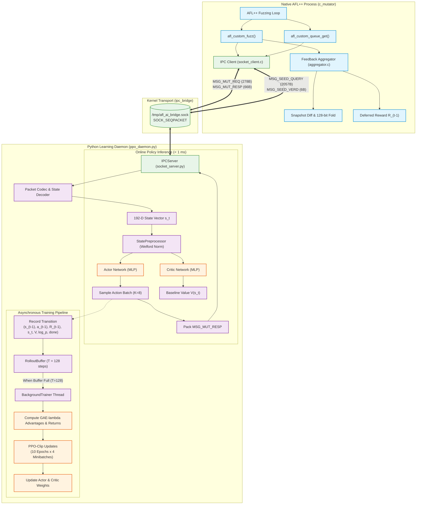
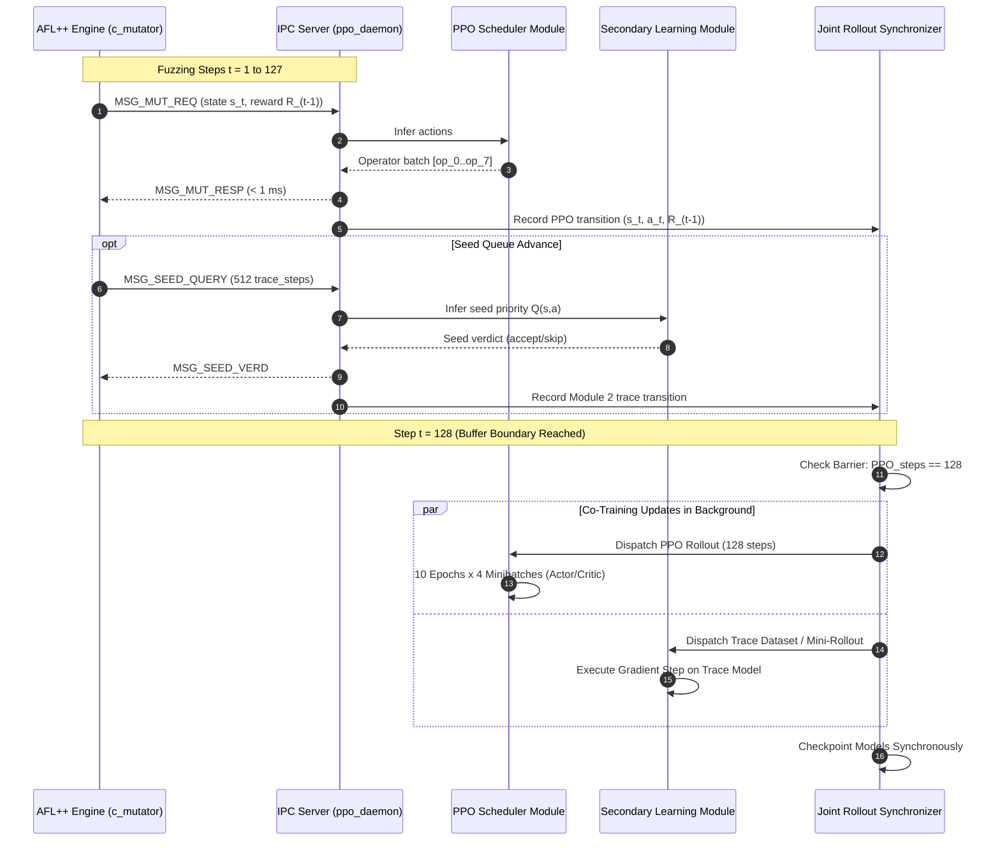

# Architecture & Implementation Specification: PPO Scheduler & Feedback Aggregator

This document details the architectural design, machine learning algorithms, training dynamics, network update schedules, and feedback mechanisms implemented across `ppo_scheduler/` and `adaptive-fuzzer/c_mutator/`. It is structured to provide the exact specifications required to synchronize and co-train secondary learning modules (e.g., execution trace analyzers, deep seed schedulers, or invariant extractors) alongside the PPO mutation scheduler on identical fuzzing trajectories.

---

## 1. High-Level Architecture Overview

The system establishes an asynchronous, closed-loop reinforcement learning pipeline bridging the C-based AFL++ fuzzing engine with Python-based neural learning agents via low-latency UNIX Domain Sockets (`AF_UNIX`, `SOCK_SEQPACKET`).



---

## 2. Machine Learning Architecture & Algorithms

### 2.1 Algorithm Family: PPO-Clip with GAE-λ
The mutation strategy scheduler uses on-policy **Proximal Policy Optimization (PPO-Clip)** with **Generalized Advantage Estimation (GAE-λ)**.

- **Objective:** Maximize cumulative fuzzing yield (novel coverage + crash discovery) while bounding policy updates per iteration to maintain training stability.
- **Action Space:** Discrete categorical distribution over $K$ mutation operators ($K \in [2, 16]$, configured to $K = 14$ in production matching the frozen C operator pool).
- **Observation Space:** Continuous 192-dimensional vector combining binary coverage projection, normalized operator usage, operator success, one-hot last operator, and fuzzing campaign telemetry.

### 2.2 Neural Network Topologies

Both networks are strictly feed-forward Multilayer Perceptrons (MLPs). The implementation strictly prohibits recurrent cells (RNN/LSTM/GRU), attention mechanisms, and value-based Q-learning.

```
Actor Network:
  Input (192) ---> Linear(192 -> 256) ---> Tanh() ---> Linear(256 -> 256) ---> Tanh() ---> Linear(256 -> K) ---> Categorical(logits)

Critic Network:
  Input (192) ---> Linear(192 -> 256) ---> Tanh() ---> Linear(256 -> 256) ---> Tanh() ---> Linear(256 -> 1) ---> Scalar V(s)
```

#### Detailed Layer Specification

| Component | Layer | Input Dim | Output Dim | Activation | Weight Initialization | Bias Initialization |
|---|---|---|---|---|---|---|
| **Actor** (`Actor`) | `net[0]` | 192 | 256 | `Tanh` | Orthogonal (`gain = 1.0`) | Zeros |
| | `net[2]` | 256 | 256 | `Tanh` | Orthogonal (`gain = 1.0`) | Zeros |
| | `net[4]` | 256 | $K$ (e.g., 14) | Linear (Logits) | Orthogonal (`gain = 0.01`) | Zeros |
| **Critic** (`Critic`) | `net[0]` | 192 | 256 | `Tanh` | Orthogonal (`gain = 1.0`) | Zeros |
| | `net[2]` | 256 | 256 | `Tanh` | Orthogonal (`gain = 1.0`) | Zeros |
| | `net[4]` | 256 | 1 | None (Scalar) | Orthogonal (`gain = 1.0`) | Zeros |

*Design Rationale:*
- **`Tanh` over `ReLU`:** Bounded activations prevent extreme activation drift during early exploratory fuzzing phases where coverage jumps significantly.
- **Output Layer Gain = 0.01:** Ensures the initial policy is nearly uniform over all $K$ mutation operators, allowing the fuzzer to explore all mutation strategies evenly before committing.

### 2.3 Mathematical Loss Formulations

The network parameters are optimized by minimizing the combined loss function:

$$\mathcal{L}_{\text{total}}(\theta, \phi) = \mathcal{L}^{\text{CLIP}}(\theta) + c_1 \mathcal{L}^{V}(\phi) - c_2 \mathcal{S}[\pi_\theta](s)$$

#### 1. Clipped Surrogate Policy Loss $\mathcal{L}^{\text{CLIP}}(\theta)$
Defined in [`losses.py`](file:///home/captainalan2/Research/ppo_scheduler/losses.py#L17-L44):

$$r_t(\theta) = \frac{\pi_\theta(a_t | s_t)}{\pi_{\theta_{\text{old}}}(a_t | s_t)} = \exp\left(\log \pi_\theta(a_t | s_t) - \log \pi_{\theta_{\text{old}}}(a_t | s_t)\right)$$

$$\mathcal{L}^{\text{CLIP}}(\theta) = - \hat{\mathbb{E}}_t \left[ \min\left(r_t(\theta)\hat{A}_t, \, \text{clip}(r_t(\theta), 1 - \epsilon, 1 + \epsilon)\hat{A}_t\right) \right]$$

- $\epsilon = 0.2$ (`CLIP_EPSILON` in [`config.py`](file:///home/captainalan2/Research/ppo_scheduler/config.py#L43)).
- The old policy probabilities $\pi_{\theta_{\text{old}}}$ are fixed at collection time and **never** modified during PPO update epochs.

#### 2. Value Function Squared Error Loss $\mathcal{L}^{V}(\phi)$
Defined in [`losses.py`](file:///home/captainalan2/Research/ppo_scheduler/losses.py#L47-L62):

$$\mathcal{L}^{V}(\phi) = \hat{\mathbb{E}}_t \left[ \left(V_\phi(s_t) - R_t\right)^2 \right]$$

- Target return $R_t = \hat{A}_t + V(s_t)$.
- Value loss coefficient $c_1 = 0.5$ (`VALUE_COEF` in [`config.py`](file:///home/captainalan2/Research/ppo_scheduler/config.py#L65)).

#### 3. Policy Entropy Bonus $\mathcal{S}[\pi_\theta]$
Defined in [`losses.py`](file:///home/captainalan2/Research/ppo_scheduler/losses.py#L65-L76):

$$\mathcal{S}[\pi_\theta](s_t) = - \sum_{k=1}^K \pi_\theta(a_k | s_t) \log \pi_\theta(a_k | s_t)$$

- Entropy coefficient $c_2 = 0.01$ (`ENTROPY_COEF` in [`config.py`](file:///home/captainalan2/Research/ppo_scheduler/config.py#L68)).
- Subtracted from the loss to penalize premature policy collapse to a single dominant mutation operator.

---

## 3. Observation Space (192-D Contract) & Preprocessing

The 192-dimensional state vector is strictly partitioned into 5 contiguous slices defined in [`state_preprocessor.py`](file:///home/captainalan2/Research/ppo_scheduler/state_preprocessor.py#L35-L44):

```
+-------------------+--------------------+--------------------+--------------------+--------------------+
|  Coverage [0:128] |   Usage [128:144]  |  Success [144:160] |  Last-Op [160:176] | Telemetry [176:192]|
|   (128 binary)    |   (16 float EMA)   |   (16 float EMA)   |  (16-D one-hot)    |   (16 float metrics)|
+-------------------+--------------------+--------------------+--------------------+--------------------+
```

### 3.1 Slice Layout Breakdown

| Slice Range | Dimension | Field Type | Semantics & Generation |
|---|---|---|---|
| `[0:128]` | 128 | Binary $\{0.0, 1.0\}$ | **Coverage Projection:** Hash-folded AFL++ SHM bitmap (modulo 128 bit mapping). Transmitted as 16 packed bytes over IPC, unpacked via `np.unpackbits`. |
| `[128:144]` | 16 | Float $\ge 0.0$ | **Operator Usage:** EMA decay of operator execution frequencies. Slots $0 \dots K-1$ populated, unused slots zero-padded. |
| `[144:160]` | 16 | Float $\ge 0.0$ | **Operator Success:** EMA of operator reward-yielding instances. |
| `[160:176]` | 16 | Binary $\{0.0, 1.0\}$ | **Last Operator One-Hot:** Strictly all zeros OR exactly one $1.0$ at index corresponding to the most recent operator. |
| `[176:192]` | 16 | Float | **Campaign Telemetry:** Global fuzzing progress indicators (queue depth, execs since coverage, exec rate, crash count, etc.). |

### 3.2 State Preprocessing & Running Normalization
Implemented in `StatePreprocessor` ([`state_preprocessor.py`](file:///home/captainalan2/Research/ppo_scheduler/state_preprocessor.py#L285-L358)):

1. **Binary Invariance:** The coverage slice `state[0:128]` is **never normalized** or modified.
2. **Continuous Normalization:** The 64 continuous features `state[128:192]` are normalized online using Welford's algorithm (`RunningNormalizer`):
   $$\mu_n = \mu_{n-1} + \frac{x_n - \mu_{n-1}}{n}, \quad M_{2,n} = M_{2,n-1} + (x_n - \mu_{n-1})(x_n - \mu_n)$$
   $$\hat{x}_i = \frac{x_i - \mu_i}{\sqrt{\sigma_i^2 + \epsilon}}, \quad \epsilon = 10^{-8}$$
3. **Training vs. Eval Mode:** Normalization statistics update **only** during environment interaction. During gradient updates, normalizer statistics are frozen (`eval_mode()`) so features remain stationary across PPO epochs.

---

## 4. The Feedback Aggregator & Reward Function

The reward function lives natively in C inside `adaptive-fuzzer/c_mutator/` to extract feedback with minimal overhead directly from AFL++ shared memory.

### 4.1 Reward Formula

Implemented in [`aggregator.c`](file:///home/captainalan2/Research/adaptive-fuzzer/c_mutator/aggregator.c#L71-L117):

$$R_{t-1} = \text{norm\_cov} + \lambda_{\text{crash}} \cdot I_{\text{crash}} + \lambda_{\text{novelty}} \cdot I_{\text{novel}}$$

Where the individual terms are computed as follows:

$$\text{delta\_cov} = \sum_{w=0}^{8191} \text{popcount64}\left(\text{cur\_bitmap}[w] \ \& \ \sim\text{prev\_bitmap}[w]\right)$$

$$\text{norm\_cov} = \frac{\text{delta\_cov}}{\ln\left(e + \text{total\_execs}\right)}$$

$$I_{\text{crash}} = \begin{cases} 1.0 & \text{if } \text{snap.saved\_crashes} > \text{agg.prev\_crashes} \\ 0.0 & \text{otherwise} \end{cases}$$

$$I_{\text{novel}} = \begin{cases} 1.0 & \text{if } \text{delta\_cov} > 0 \\ 0.0 & \text{otherwise} \end{cases}$$

#### Constants & Parameters

| Parameter | Value | Location | Role |
|---|---|---|---|
| `LAMBDA_CRASH` | `10.0` | [`aggregator.c#L22`](file:///home/captainalan2/Research/adaptive-fuzzer/c_mutator/aggregator.c#L22), [`config.py#L75`](file:///home/captainalan2/Research/ppo_scheduler/config.py#L75) | Heavily weights unique crash discovery. |
| `LAMBDA_NOVELTY` | `1.0` | [`aggregator.c#L23`](file:///home/captainalan2/Research/adaptive-fuzzer/c_mutator/aggregator.c#L23), [`config.py#L78`](file:///home/captainalan2/Research/ppo_scheduler/config.py#L78) | Rewards expanding edge discovery. |
| `M_E` | $e \approx 2.71828$ | [`aggregator.c#L18`](file:///home/captainalan2/Research/adaptive-fuzzer/c_mutator/aggregator.c#L18) | Prevents denominator from dropping below 1.0. |
| `HISTORY_DECAY` | `0.95` | [`aggregator.h#L29`](file:///home/captainalan2/Research/adaptive-fuzzer/c_mutator/aggregator.h#L29) | EMA decay rate for operator usage slots. |

### 4.2 Why Deferred Reward $R_{t-1}$?
In native fuzzing loops:
1. At step $t-1$, the mutator requests an action $a_{t-1}$.
2. AFL++ mutates the testcase using $a_{t-1}$ and invokes the forkserver target.
3. Target executes; execution trace and crash status are written to shared memory.
4. When AFL++ re-enters `afl_custom_fuzz()` at step $t$, the mutator queries the Aggregator.
5. The Aggregator diffs the *current* bitmap against the *previous baseline*, computing the yield of action $a_{t-1}$.
6. Therefore, the reward observed at time $t$ is strictly $R_{t-1}$.

### 4.3 64-Bit Fast Bitmap Diffing
AFL++ bitmaps are 65,536 bytes ($2^{16}$ edges). To prevent fuzzing stalls, [`aggregator.c`](file:///home/captainalan2/Research/adaptive-fuzzer/c_mutator/aggregator.c#L76-L88) casts the memory to `uint64_t*` (8,192 words) and executes hardware-accelerated popcount:
```c
const uint64_t *cur64  = (const uint64_t *)snap->trace_bits;
const uint64_t *prev64 = (const uint64_t *)agg->prev_bitmap;
for (size_t i = 0; i < 8192; i++) {
    uint64_t novel = cur64[i] & (~prev64[i]);
    if (novel)
        delta_cov += (uint32_t)__builtin_popcountll(novel);
}
```

---

## 5. Data Training & Network Update Mechanics

This section specifies the exact timing, triggers, and execution flow of training updates.

### 5.1 Update Cadence & Trigger Conditions

The training cadence is strictly dictated by the rollout buffer capacity:

$$\text{Trigger Condition: } \text{len}(\text{RolloutBuffer}) == \text{ROLLOUT\_LENGTH} = 128$$

```
Step Count:        0            ...            127           128 (Trigger Update!)
Buffer State:     [t_0]         ...          [t_127]         [Buffer Full]
Action:       Collect only                 Collect only    Submit to Trainer -> Reset Buffer
```

#### Transition Accumulation Dynamics
- In `c_mutator`, each `MSG_MUT_REQ` asks for a batch of `MUTATOR_BATCH_SIZE = 8` operators.
- Each `MSG_MUT_REQ` packet contains **one** deferred reward $R_{t-1}$ and **one** 192-D state snapshot $s_t$.
- Consequently, **1 IPC request = 1 transition** recorded in `RolloutBuffer`:
  $$\tau_t = \left(s_{t-1}, a_{t-1}, R_{t-1}, s_t, V(s_{t-1}), \log \pi(a_{t-1} | s_{t-1}), d_t\right)$$
- An update occurs once every **128 IPC mutation requests** (equivalent to $128 \times 8 = 1,024$ fuzzing testcase executions under batch size 8).

### 5.2 Generalized Advantage Estimation (GAE) Step
When `RolloutBuffer.compute_returns_and_advantages()` runs ([`buffer.py#L95-L145`](file:///home/captainalan2/Research/ppo_scheduler/buffer.py#L95-L145)):

1. **Bootstrap Value $V(s_T)$:**
   $$V_{\text{next}} = \begin{cases} 0.0 & \text{if } d_T = \text{True} \\ V_\phi(s_T) & \text{otherwise} \end{cases}$$
2. **Backward Advantage Accumulation ($t = T-1 \dots 0$):**
   $$\delta_t = r_t + \gamma V(s_{t+1})(1 - d_t) - V(s_t)$$
   $$\hat{A}_t = \delta_t + \gamma \lambda (1 - d_t) \hat{A}_{t+1}$$
   $$R_t = \hat{A}_t + V(s_t)$$
   With $\gamma = 0.95$ and $\lambda = 0.95$.
3. **Advantage Normalization:**
   $$\hat{A}_t \leftarrow \frac{\hat{A}_t - \mu_A}{\sigma_A + 10^{-8}}$$

### 5.3 Optimization Epochs & Minibatches
When `agent.update(buffer)` executes ([`agent.py#L125-L235`](file:///home/captainalan2/Research/ppo_scheduler/agent.py#L125-L235)):

- **Epoch Count (`PPO_EPOCHS`):** 10
- **Minibatch Size (`MINIBATCH_SIZE`):** 32
- **Minibatches per Epoch:** $\frac{128}{32} = 4$ minibatches
- **Total Gradient Steps per Rollout:** $10 \text{ epochs} \times 4 \text{ minibatches} = \mathbf{40 \text{ parameter updates}}$

```
For epoch = 1 to 10:
    indices = random_permutation(128)
    For start = 0, 32, 64, 96:
        batch = indices[start : start + 32]
        Compute policy_loss, value_loss, entropy
        total_loss = policy_loss + 0.5 * value_loss - 0.01 * entropy
        optimizer.zero_grad()
        total_loss.backward()
        clip_grad_norm_(parameters, max_norm=0.5)
        actor_optimizer.step()   # lr = 3e-4
        critic_optimizer.step()  # lr = 1e-3
```

### 5.4 Concurrency & Latency Decoupling
To prevent AFL++ forkservers from hitting the 100 ms `SO_RCVTIMEO` threshold during neural network backpropagation:

1. **Inference Thread (Main Socket Loop):**
   - Receives `MSG_MUT_REQ`.
   - Preprocesses $s_t$, computes actor forward pass (`select_action`), generates 8 operator IDs.
   - Transmits `MSG_MUT_RESP` back over `SOCK_SEQPACKET` immediately ($< 1$ ms latency).
2. **`BackgroundTrainer` Thread ([`ppo_daemon.py#L48-L88`](file:///home/captainalan2/Research/ppo_scheduler/ppo_daemon.py#L48-L88)):**
   - Holds an internal thread-safe `queue.Queue(maxsize=4)`.
   - When the 128-step buffer is full, `trainer.submit(buffer)` hands off the buffer to the worker thread.
   - The worker runs the 40 gradient updates asynchronously in the background (~150 ms compute time).
   - The main socket loop continues serving AFL++ mutation requests without delay.

---

## 6. Blueprint for Synchronizing a Secondary Learning Module

To train a second learning module (e.g., Deep Seed Prioritizer, Branch Coverage Predictor, or Invariant Miner) concurrently on the same fuzzing execution traces, the two learning modules must be synchronized at the data and update boundaries.

### 6.1 Shared Execution Trace Sources

AFL++ generates two distinct messages over the IPC bridge:

```
                  +----------------------------------------------+
                  |         AFL++ Execution Trace Data           |
                  +----------------------+-----------------------+
                                         |
                 +-----------------------+-----------------------+
                 |                                               |
                 v                                               v
        [MSG_MUT_REQ (0x01)]                           [MSG_SEED_QUERY (0x03)]
    - Frequency: Every batch (8 fuzzes)            - Frequency: Every queue seed switch
    - Payload: 192-D PPO state (coverage fold      - Payload: Seed ID + 512 trace steps
      + history decay + telemetry)                   (edge_id, hit_count_bin, fault_flags)
    - Consumer: PPO Mutation Scheduler             - Consumer: Secondary Module (Seed Scorer)
```

### 6.2 Synchronization Patterns for Co-Training



### 6.3 Recommended Integration Architectures

#### Architecture Option A: Joint Daemon Multi-Task Architecture (Recommended)
Embed the secondary learning module directly into the `ppo_daemon.py` event loop:
1. **Shared State/Trace Bus:** Modify `handle_client()` so that:
   - `MSG_MUT_REQ` feeds both `PPOAgent` and Module 2's feature buffer.
   - `MSG_SEED_QUERY` parses `steps[512]` into a PyTorch tensor `(batch, 512, 4)` and invokes Module 2's forward pass.
2. **Synchronized Barrier Updates:**
   Use a unified `JointRolloutBuffer` that pairs:
   $$\text{Sample}_t = \left(s_t^{\text{PPO}}, a_t^{\text{PPO}}, R_t, \text{Trace}_t^{\text{Mod2}}, y_t^{\text{Mod2}}\right)$$
   When step counter $t \pmod{128} == 0$, submit the joint buffer to the background thread to train both models simultaneously.

#### Architecture Option B: Independent Daemons via Dual Sockets
Run PPO and Module 2 as separate OS processes:
1. `c_mutator` maintains two client handles:
   - `client_ppo` $\to$ `/tmp/afl_ppo_bridge.sock`
   - `client_mod2` $\to$ `/tmp/afl_mod2_bridge.sock`
2. **Synchronization via Fuzzing Step Epochs:**
   Both daemons use identical `ROLLOUT_LENGTH = 128`. Since both receive events in lock-step from the same AFL++ execution sequence, their internal rollout counts advance at the exact same pace.

---

## 7. Hyperparameter & Configuration Reference

All active parameters across `ppo_scheduler/config.py` and `adaptive-fuzzer/c_mutator/`:

```python
# ppo_scheduler/config.py
STATE_DIM        = 192      # Total observation dimension
ACTION_DIM       = 14       # Discrete actions (matches TOTAL_OPERATORS in operators.h)
GAMMA            = 0.95     # Discount factor
GAE_LAMBDA       = 0.95     # Generalized advantage estimation parameter
CLIP_EPSILON     = 0.2      # PPO clipping parameter epsilon
ACTOR_LR         = 3e-4     # Actor Adam learning rate
CRITIC_LR        = 1e-3     # Critic Adam learning rate
ROLLOUT_LENGTH   = 128      # Buffer collection capacity before update
PPO_EPOCHS       = 10       # Optimization epochs per rollout
MINIBATCH_SIZE   = 32       # Minibatch size (128 / 32 = 4 minibatches/epoch)
VALUE_COEF       = 0.5      # Critic loss coefficient c_1
ENTROPY_COEF     = 0.01     # Entropy bonus coefficient c_2
MAX_GRAD_NORM    = 0.5      # Gradient norm clipping threshold
LAMBDA_CRASH     = 10.0     # Crash reward coefficient
LAMBDA_NOVELTY   = 1.0      # Novel coverage reward coefficient
COVERAGE_WINDOW  = 100      # Window length for rolling coverage calculation
```

```c
// c_mutator/aggregator.h & protocol.h
#define DEFAULT_SOCKET_PATH "/tmp/afl_ai_bridge.sock"
#define AFL_BITMAP_BYTES    65536    // 64 KB AFL++ coverage map
#define HISTORY_DIM         64       // Contiguous float slots
#define HISTORY_DECAY       0.95f    // Exponential moving average decay
#define MUT_BATCH_MAX       32       // Maximum actions per response
#define MUTATOR_BATCH_SIZE  8        // Actions requested per fuzzing batch
#define TRACE_STEPS_MAX     512      // Max execution trace steps per seed
```

---

## 8. Source Code Cross-Reference Map

| Component / Concept | Primary File | Key Functions / Classes | Lines |
|---|---|---|---|
| **Hyperparameter Definitions** | [`config.py`](file:///home/captainalan2/Research/ppo_scheduler/config.py) | `PPOConfig`, `_validate()` | L15–L136 |
| **Actor & Critic Networks** | [`networks.py`](file:///home/captainalan2/Research/ppo_scheduler/networks.py) | `Actor`, `Critic`, `_init_weights()` | L27–L122 |
| **Observation Contract (192-D)** | [`state_preprocessor.py`](file:///home/captainalan2/Research/ppo_scheduler/state_preprocessor.py) | `COVERAGE_SLICE`, `validate_state()` | L35–L44, L240–L280 |
| **Running Feature Normalizer** | [`state_preprocessor.py`](file:///home/captainalan2/Research/ppo_scheduler/state_preprocessor.py) | `RunningNormalizer`, `StatePreprocessor` | L285–L358 |
| **GAE-λ & Rollout Buffer** | [`buffer.py`](file:///home/captainalan2/Research/ppo_scheduler/buffer.py) | `RolloutBuffer`, `compute_returns_and_advantages()` | L24–L145 |
| **PPO-Clip Loss Formulation** | [`losses.py`](file:///home/captainalan2/Research/ppo_scheduler/losses.py) | `ppo_policy_loss()`, `value_loss()`, `entropy_loss()` | L17–L101 |
| **Agent Optimization Loop** | [`agent.py`](file:///home/captainalan2/Research/ppo_scheduler/agent.py) | `PPOAgent.select_action()`, `PPOAgent.update()` | L77–L235 |
| **Daemon & Threaded Trainer** | [`ppo_daemon.py`](file:///home/captainalan2/Research/ppo_scheduler/ppo_daemon.py) | `BackgroundTrainer`, `handle_client()`, `decode_192d_state()` | L48–L215 |
| **Fast Bitmap Popcount Diff** | [`aggregator.c`](file:///home/captainalan2/Research/adaptive-fuzzer/c_mutator/aggregator.c) | `agg_compute_reward()` | L71–L117 |
| **128-Bit Bitmap Projection** | [`aggregator.c`](file:///home/captainalan2/Research/adaptive-fuzzer/c_mutator/aggregator.c) | `agg_fold_bitmap()` | L43–L57 |
| **Decaying History Update** | [`aggregator.c`](file:///home/captainalan2/Research/adaptive-fuzzer/c_mutator/aggregator.c) | `agg_update_history()` | L126–L134 |
| **AFL++ Hook Execution** | [`mutator.c`](file:///home/captainalan2/Research/adaptive-fuzzer/c_mutator/mutator.c) | `afl_custom_fuzz()`, `replenish_action_queue()` | L47–L94, L174–L210 |
